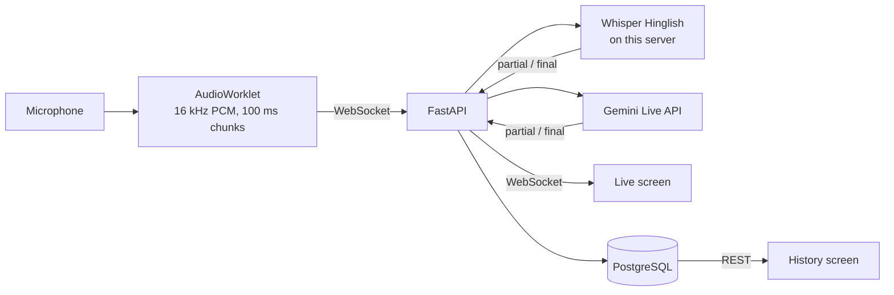

# Speech to Text

Live speech to text for mixed Hindi and English. You speak into the browser and the words appear while you are still talking. Every recording is saved in PostgreSQL, and the History screen lets you search, open, edit and delete them.

Built for the Procucev AI Tech hiring assignment.

## What it does

- **Live transcription** over a WebSocket, with grey interim words that turn into fixed text at each pause.
- **Two speech engines** behind one switch:
  - an open-source Whisper model tuned for Hinglish, running on the same server as the app
  - Google's Gemini Live transcription API
- **History with full CRUD**: recordings are created by speaking, or you can add a typed note. Each one can be read, searched, edited and deleted.
- **PostgreSQL** with two tables, `transcripts` and `segments`, managed by Alembic migrations.

## How it works



1. The browser captures the microphone with an `AudioWorklet`, converts it to 16 kHz 16-bit mono PCM and sends a chunk every 100 ms.
2. The server passes the audio to the chosen engine. Both engines implement the same small interface (`feed`, `end`, `events`), so the WebSocket route does not know which one it is talking to.
3. The engine sends back two kinds of text. A `partial` is a guess that can still change. A `final` is fixed.
4. A row is created in `transcripts` when the recording starts, and each `final` is saved to `segments` the moment it arrives. If the connection drops, what was heard is still there.

### The two engines

| | Open source | Gemini Live |
|---|---|---|
| Model | [Oriserve/Whisper-Hindi2Hinglish-Swift](https://huggingface.co/Oriserve/Whisper-Hindi2Hinglish-Swift) (Apache-2.0), run with faster-whisper on CPU | `gemini-3.5-transcribe-live` |
| Runs | inside the app container | Google's API, free tier |
| Hindi is written | in Roman letters: "mujhe kal office jaana hai" | as the API returns it: Devanagari for some sentences, Roman letters for others |
| Needs | nothing | `GEMINI_API_KEY` |

The assignment names "Gemini Live 3.1". Google now lists that model as legacy and has a model made for live transcription, so that is the default. The older one also works with this code (`GEMINI_MODEL=gemini-3.1-flash-live-preview`), but it is a conversation model: it returns text only at each pause, so words do not appear while you are speaking.

### Streaming with a model that does not stream

Whisper transcribes a finished clip. It has no streaming mode. The streaming is done in [`backend/app/stt/whisper.py`](backend/app/stt/whisper.py):

- Incoming audio goes into a buffer. A voice activity detector (Silero, bundled with faster-whisper) marks where speech is.
- About twice a second the open utterance is transcribed again with a fast greedy decode and sent as a `partial`.
- When the detector sees a pause of half a second, the utterance is transcribed once more with beam search, sent as a `final`, and cut from the buffer.
- Silence is dropped, and speech that runs past 20 seconds without a pause is cut so the buffer stays small.
- A short list of procurement words (RFQ, BOQ, quotation, ...) is passed to both engines as a hint. It is set with `VOCABULARY`.

## Run it

You need Docker.

```bash
docker compose up --build
```

Open http://localhost:8000. The first build downloads the Whisper model and converts it for CPU, which takes a few minutes.

To turn on the Gemini engine, get a free key from [Google AI Studio](https://aistudio.google.com/apikey) and put it in `.env`:

```bash
cp .env.example .env
# set GEMINI_API_KEY in .env
```

`.env` is in `.gitignore`. No key is stored in this repository.

### Development

```bash
docker compose up -d db

# convert the model once
uvx --from ctranslate2 --with "transformers[torch]" ct2-transformers-converter \
  --model Oriserve/Whisper-Hindi2Hinglish-Swift --output_dir models/hinglish-swift \
  --quantization int8 --copy_files tokenizer.json preprocessor_config.json

cd backend
uv sync
uv run alembic upgrade head
uv run uvicorn app.main:app --reload

cd ../frontend
npm install
npm run dev
```

The Vite dev server on http://localhost:5173 proxies `/api` and `/ws` to the backend.

To test the live path without a microphone, stream a 16 kHz mono WAV file in real time:

```bash
cd backend
uv run python ../scripts/stream_wav.py path/to/clip.wav whisper
```

## API

History is scoped to the browser. The frontend keeps a random id in `localStorage` and sends it as `X-Client-Id`.

| Method | Path | What it does |
|---|---|---|
| `GET` | `/api/transcripts?q=&limit=&offset=` | List, newest first, with search on title and text |
| `POST` | `/api/transcripts` | Create a typed note |
| `GET` | `/api/transcripts/{id}` | One transcript with its segments |
| `PATCH` | `/api/transcripts/{id}` | Edit title or text |
| `DELETE` | `/api/transcripts/{id}` | Delete |
| `GET` | `/api/transcripts/stats` | Totals for the tiles on the History screen |
| `GET` | `/api/engines` | Which engines this server has |
| `WS` | `/ws/transcribe?engine=&client_id=` | Live session |

Interactive docs are at `/docs`.

The WebSocket takes binary PCM frames and one text message, `{"type": "stop"}`. It sends `ready`, then `partial` and `final` messages, then `done` with the id of the saved transcript.

## Tests

```bash
cd backend
uv run pytest
```

- **CRUD API**: create, read, list, paging, search, update, delete, validation, and that one browser cannot see another's transcripts.
- **Live session**: a full WebSocket session against a fake engine, a silent session that saves nothing, the time limit, the busy limit and bad input.
- **Streaming logic**: that a pause closes an utterance with the right timestamps, that open speech gives partials, and that silence is dropped. These run without the model.
- **Real model**: streams a Hinglish clip through the real Whisper model. It is skipped when the model or the clip is not on disk.

## Choices I made

- **No login.** A reviewer should be able to open the link and talk. History is separated by a random browser id. This keeps visitors out of each other's lists, but it is not real authentication.
- **A plain WebSocket, not LiveKit or Pipecat.** Those are built for two-way voice agents with many participants. This app sends audio one way, and writing the streaming by hand keeps the interesting part in this repository.
- **Roman letters for Hindi in the open-source engine.** That is how people type Hinglish, and it is what the model was trained to write.
- **One container for the app.** FastAPI serves the built React files, the API and the WebSocket, so there is one thing to deploy.
- **Limits for a public demo.** A session stops after `MAX_SESSION_SECONDS` (3 minutes by default) and the server takes `MAX_SESSIONS` sessions at once.

## What I would do next

- Real accounts.
- Keep the audio so a transcript can be played back and corrected against it.
- Show only the words that two decodes in a row agree on, so interim text flickers less.
- Run the larger model of the same family (`Whisper-Hindi2Hinglish-Apex`) on a GPU for better accuracy.
- A fixed set of real Hinglish recordings to score each engine on every change.

## Layout

```
backend/
  app/
    main.py            app, engine loading, static files
    routes/live.py     WebSocket session
    routes/transcripts.py   CRUD
    stt/whisper.py     open-source engine and the streaming loop
    stt/gemini.py      Gemini Live engine
    stt/fake.py        engine used in tests
    models.py          tables
  alembic/             migrations
  tests/
frontend/
  public/pcm-worklet.js   microphone to PCM
  src/useLive.ts          recording state and WebSocket
  src/pages/              Live, History, Detail, About
scripts/stream_wav.py     stream a WAV file to the server
```
